<!-- adamatnoh · GitHub profile README · draft -->

<div align="center">

<a href="https://adamnajmi.com"></a>

<a href="https://adamnajmi.com">
  
</a>

<a href="https://adamnajmi.com"></a>&nbsp;<a href="https://www.linkedin.com/in/adamnajmi"></a>&nbsp;<a href="mailto:adamnajminoh@gmail.com"></a>

</div>


```console
$ whoami
Adam Najmi · Full Stack Software Engineer

$ cat about.txt
3 years building production web, mobile and data systems for fintech and government.
Strengths: API security, authentication design, third-party integrations, technical leadership.

$ cat now.txt
Full Stack Developer @ Mechanikos Sdn. Bhd. (Aug 2026 – now)
Leading 6 developers on SPTK, a national MIS for 5,000+ TABIKA preschool centres
under KEMAS — Laravel · Vue 3 · TypeScript · Playwright.

$ history | tail -3
2023–2026  Software Engineer @ Rapidz Inc. (Clarity Techworks)
           HMAC request signing, JWT (RS256) auth, cross-platform crypto wallet, Power BI from scratch
2022–2023  Software Engineer Intern @ Intel Technology Sdn. Bhd.
2019–2023  B.CS (Software Engineering) @ Universiti Teknologi Malaysia · CGPA 3.88
```


### `$ ls ~/stack`

<p align="left">


<br />


<br />


<br />


<br />


</p>


### `$ ls ~/projects`



<table>
<tr>
<td width="50%" valign="top">🖥️ <b><a href="https://github.com/adamatnoh/adamnajmi.com">adamnajmi.com</a></b> <br /> Terminal-inspired portfolio with an AI chatbot (Google Gemini), a daily word-hunt minigame and streak-based rewards. Try your luck at <b><a href="https://adamnajmi.com">adamnajmi.com</a></b> 🔥 <br /><sub><code>Astro</code> <code>React</code> <code>Tailwind CSS</code> <code>Vercel</code></sub></td>
<td width="50%" valign="top">🕌 <b><a href="https://github.com/adamatnoh/islamic-tv-launcher">islamic-tv-launcher</a></b> <br /> <i>Clear TV Islamic</i>: an ad-free Android TV home launcher for the Mi TV Stick, with JAKIM prayer times, the azan at every prayer, a Quran-verse screensaver, child lock and a phone remote. <br /><sub><code>Java</code> <code>Android TV</code> · built on CleanYourTV (MIT)</sub></td>
</tr>
<tr>
<td width="50%" valign="top">🏥 <b><a href="https://github.com/adamatnoh/hospital-scheduling-system">hospital-scheduling-system</a></b> <br /> Final Year Project at UTM: hospital scheduling with real-time availability booking, doctor schedule management, reminders and an admin dashboard. <br /><sub><code>Laravel</code> <code>PHP</code> <code>Blade</code></sub></td>
<td width="50%" valign="top">🩺 <b><a href="https://github.com/adamatnoh/icare">icare</a></b> <br /> iCare, a project built for an Internet Programming course. <br /><sub><code>Java</code> <code>CSS</code> <code>JavaScript</code></sub></td>
</tr>
</table>


### `$ ./stats --github`

<div align="center">
  
  
  <br />
  
</div>

<!--
  Contribution snake: enable after .github/workflows/snake.yml has run once
  (it publishes to the `output` branch), then remove these comment markers.

<picture>
  <source media="(prefers-color-scheme: dark)" srcset="https://raw.githubusercontent.com/adamatnoh/adamatnoh/output/github-snake-dark.svg" />
  
</picture>
-->

<div align="center">
<sub><code>$ ./daily_cipher.sh</code> · a new word every day on <a href="https://adamnajmi.com">adamnajmi.com</a> · ● open for opportunities</sub>
<br /><br />

</div>
